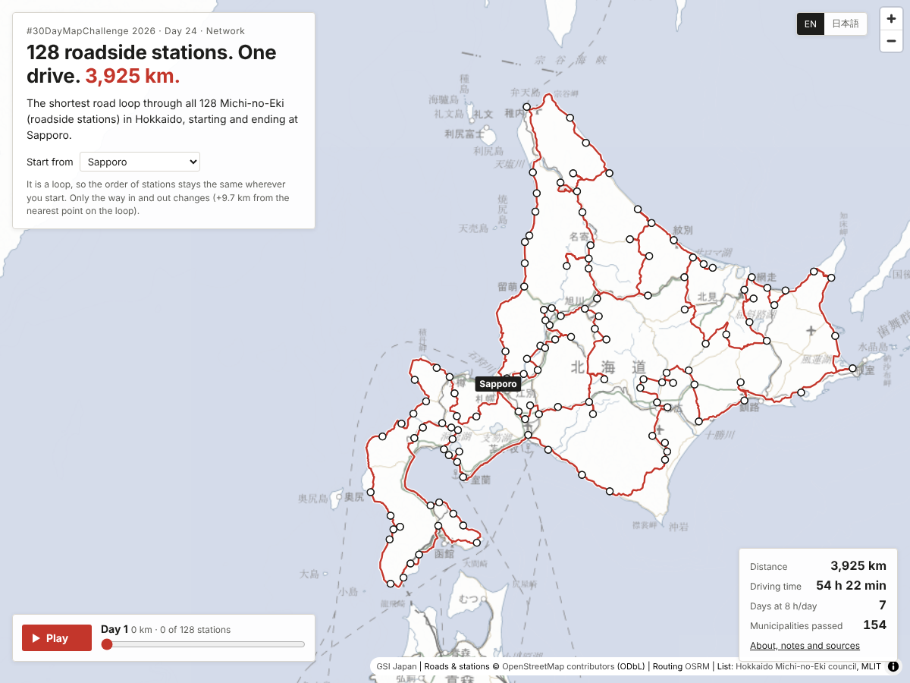

# Every roadside station in Hokkaido, in one drive

**北海道の道の駅を、一筆書きで** — #30DayMapChallenge 2026, Day 24 "Network"

**128 roadside stations. One drive. 3,925 km.**

https://shinyanakashima.github.io/30daymapchallenge-2026day24-michinoeki-tour/



Hokkaido has more Michi-no-Eki (道の駅: government-registered roadside stations with parking, toilets, information and local shops) than any other region of Japan, and a stamp rally invites drivers to visit them all. This map shows the shortest round trip by car, on real roads, that visits every station in Hokkaido once and returns to the start.

北海道は道の駅が全国で最も多い地域です。北海道のすべての道の駅を、実際の道路で1回ずつ回って出発地に戻る最短の巡回ルート（巡回セールスマン問題）を計算し、地図にしました。画面は英語が基本で、右上のボタンで日本語に切り替えられます（`?lang=ja` でも可）。

## Results / 結果

Start and end: Sapporo Station. 出発・到着：札幌駅

| | |
|---|---|
| Stations / 道の駅の数 | 128 (as of 2026-11-08) |
| Total distance / 総距離 | 3,925.2 km |
| Total driving time / 総運転時間 | 54 h 22 min（54時間22分） |
| Days at 8 h of driving a day / 1日8時間運転した場合の日数 | 7 days |
| Municipalities the route passes through / 通る市町村の数 | 154 of 179 |
| Municipalities with a station / 道の駅がある市町村 | 116 |

The loop itself (stations only, without the way in from Sapporo) is 3,915.4 km and 54 h 12 min.

### Other start points / 別の出発地

The tour is a closed loop, so the order of stations is the same whatever the start; only the short way in and out changes. The start point is joined to the loop between the two consecutive stations where the detour is smallest.

巡回ルートなので、出発地を変えても道の駅を回る順番（経路）は同じです。出発地は、巡回ルート上で寄り道が最も小さくなる2駅の間に接続しています。画面の「Start from / 出発地」で切り替えられます（`?start=obihiro` など）。

| Start / 出発地 | Distance / 距離 | Driving time / 運転時間 | Days / 日数 | Way in and out vs. loop / 巡回ルートからの増加 |
|---|---|---|---|---|
| Sapporo Station / 札幌駅 | 3,925.2 km | 54 h 22 min（54時間22分） | 7 | +9.7 km |
| Asahikawa Station / 旭川駅 | 3,916.0 km | 54 h 14 min（54時間14分） | 7 | +0.5 km |
| Obihiro Station / 帯広駅 | 3,918.1 km | 54 h 14 min（54時間14分） | 7 | +2.7 km |
| Hakodate Station / 函館駅 | 3,918.5 km | 54 h 20 min（54時間20分） | 7 | +3.1 km |
| Kushiro Station / 釧路駅 | 3,921.2 km | 54 h 22 min（54時間22分） | 7 | +5.8 km |
| New Chitose Airport / 新千歳空港 | 3,926.5 km | 54 h 26 min（54時間26分） | 7 | +11.1 km |

## Method / 計算方法

1. **Station list.** The current list of Hokkaido stations is taken from the Hokkaido Michi-no-Eki liaison council (北海道地区「道の駅」連絡会, names, municipality, address and the official English names) and checked against the national list published by MLIT (国土交通省). Both give 128 stations; stations whose registration was cancelled (足寄湖, フォーレスト276大滝, まるせっぷ) are excluded.
2. **Locations.** Each station is matched to an OpenStreetMap feature whose name contains 道の駅 and the station name, within 3 km of the location on the council's map (rest areas and mapped areas preferred). 126 stations were matched by name, 1 by proximity to a feature named 道の駅, and 1 (花ロードえにわ) was placed from its address with the GSI address search (国土地理院 地名・住所検索). Every location is within 147 m of the council's position. The resulting table is [`data/stations.csv`](data/stations.csv). The National Land Numerical Information dataset (国土数値情報「道の駅」) was not used because it is out of date.
3. **Road network.** OSRM 5.27.1 with the default car profile, built and run locally (Docker) from the OpenStreetMap Hokkaido extract (data timestamp 2026-11-07T00:12:21Z). One OSRM `table` request gives the distance and driving-time matrix between all stations and the start points. The public OSRM demo server was not used.
4. **Travelling salesman problem.** The tour minimises total driving time. Times differ by direction (one-way streets, turn costs), so the problem is solved as an asymmetric TSP on times rounded to 0.1 s. Two solvers are run on the same matrix and the shorter tour is kept:
   - Google OR-Tools 9.15 routing solver, guided local search, 4 runs (first-solution strategies: path cheapest arc, Christofides, savings, local cheapest insertion), time limit 300 s per run;
   - LKH-3 (Lin–Kernighan–Helsgaun) through the `elkai` package, 1,000 runs.

   OR-Tools runs ended between 195,664.7 s and 196,759.0 s of driving; LKH-3 found 195,118.9 s (0.28% shorter than the best OR-Tools run), the same value with 10, 100 and 1,000 runs, so the LKH-3 tour is used. Neither method proves optimality, so this is the best tour found, not a proven optimum.
5. **Route and days.** The road geometry of every leg comes from OSRM `route` and is simplified to 25 m for the web page. The day breaks split the driving time into 8-hour days; stops, meals and sleep are not included. Municipalities passed are counted by intersecting the full-resolution route with OpenStreetMap municipal boundaries (admin_level 7, 179 municipalities).
6. **Ferries.** No station in Hokkaido is on an island without a road link (none on Rishiri, Rebun or Okushiri), so no ferry is needed. OSRM's car profile can route over ferry lines, but the tour does not use any.

## Notes / 注記

- Distances and times are calculated by OSRM from OpenStreetMap road data. Traffic, road closures, seasonal (winter) closures and opening hours are not considered.
  距離と時間は OpenStreetMap の道路データと OSRM による計算で、渋滞・通行止め・季節の道路閉鎖・営業時間は考慮していません。
- The number of stations is as of 2026-11-08.
  道の駅の数は2026-11-08時点のものです。
- This is not an official route of the Hokkaido Michi-no-Eki stamp rally.
  北海道「道の駅」スタンプラリーの公式のルートではありません。

## Data sources / データの出典

| Data | Source | Retrieved |
|---|---|---|
| Station list (names, addresses, English names) | 北海道地区「道の駅」連絡会 [北の道の駅 住所等一覧](https://hokkaido-michinoeki.jp/ichiran/), [English](https://hokkaido-michinoeki.jp/en/) | 2026-11-08 |
| Station list (national, for checking the count) | 国土交通省 [「道の駅」一覧](https://www.mlit.go.jp/road/Michi-no-Eki/list.html) (list.xlsx, after the 65th registration of 4 Sep 2026) | 2026-11-08 |
| Roads, station locations, municipal boundaries | © [OpenStreetMap contributors](https://www.openstreetmap.org/copyright), ODbL. Hokkaido extract from [openstreetmap.fr](https://download.openstreetmap.fr/extracts/asia/japan/) (same data as the Geofabrik extract) | data as of 2026-11-07T00:12:21Z |
| Routing | [OSRM](https://project-osrm.org/) | |
| Fallback geocoding | 国土地理院 [地名・住所検索API](https://msearch.gsi.go.jp/) | 2026-11-08 |
| Background map | 国土地理院 [地理院タイル（淡色地図）](https://maps.gsi.go.jp/development/ichiran.html) | |

The derived data in `data/` and `web/data/` contain OpenStreetMap data and are available under the ODbL.

## Reproduce / 再現手順

Requirements: Docker, Python 3.11+, Node.js 20+ with Playwright (Chromium).

```sh
pip install -r requirements.txt
./run_all.sh
```

`run_all.sh` runs these steps:

| Step | Script | Output |
|---|---|---|
| Download the Hokkaido OSM extract (set `PBF_URL` to use Geofabrik instead), build OSRM (car, MLD) and start `osrm-routed` on port 5000 | `run_all.sh` | `data/osm/` |
| Download the official lists | `scripts/fetch_lists.py` | `data/raw/` |
| Extract 道の駅 features and municipal boundaries from OSM | `scripts/osm_extract.py` | `data/work/` |
| Match stations to locations | `scripts/locate.py` | `data/stations.csv` |
| Distance and time matrix | `scripts/matrix.py` | `data/work/matrix.json` |
| Solve the TSP (about 25 minutes) | `scripts/solve.py` | `data/work/tour.json` |
| Route geometry and totals | `scripts/build_web_data.py` | `web/data/tour.json`, `data/summary.json` |
| Browser check (console errors, HTTP errors) and screenshot | `scripts/check_page.cjs` | `docs/screenshot.png` |

To view the page locally: `python3 -m http.server -d web` and open http://localhost:8000/.

The page (`web/`) is plain HTML, CSS and JavaScript with [MapLibre GL JS](https://maplibre.org/) and is deployed to GitHub Pages by `.github/workflows/pages.yml`.

## License

Code: MIT (see [LICENSE](LICENSE)). Data derived from OpenStreetMap: ODbL.
